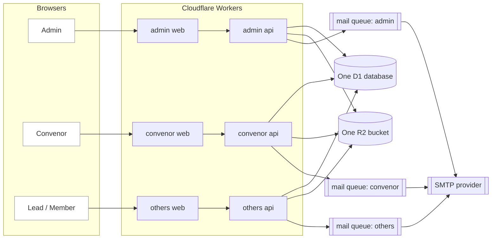
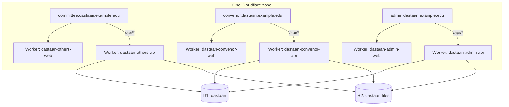
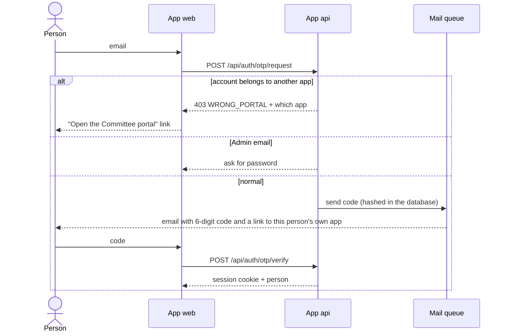
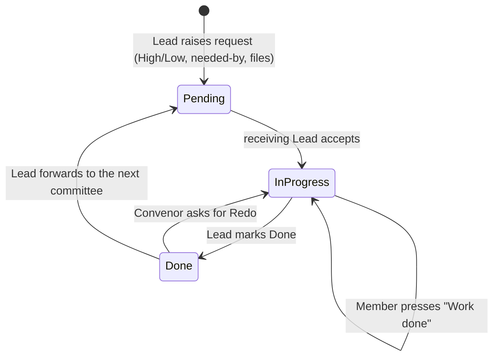
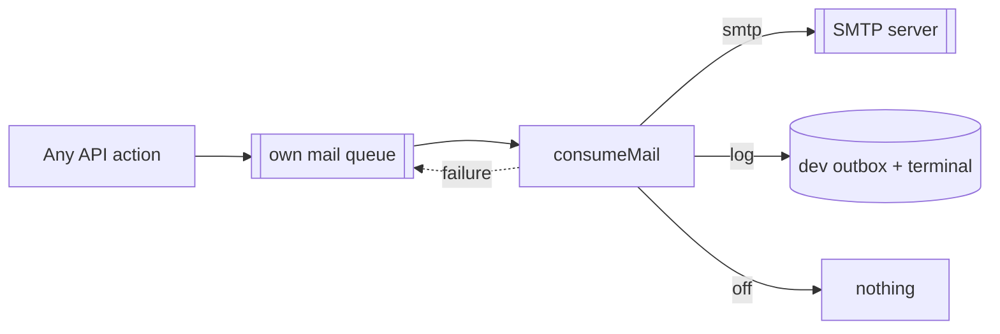

# High-Level Design (HLD)

## 1. Purpose

The platform lets the fest's committees hand work to each other with a clear owner, a deadline and a history. One record per request replaces chat messages and spreadsheets.

## 2. People and what they can do

| Role | Does |
|---|---|
| Admin (listed in `ADMIN_EMAILS`) | Creates Convenors and Committee Leads, edits or removes them, manages committees and permissions, answers support requests. Signs in with email + password. |
| Convenor | Sees every request, reviews Done work (Redo), approves or declines committee changes, writes to everyone. |
| Committee Lead (one per committee) | Raises requests to other committees, moves work through Pending → In progress → Done, forwards finished work, adds and manages members, handles member change requests. |
| Member | Sees their committee's work, presses **Work done**, asks their Lead for a change. |

## 3. Architecture in one picture

Three apps. Each app is a web app plus its own API. All APIs use the same database and file store.

- Each web app calls only its own API, on its own domain (`/api/*`). No cross-domain calls, no CORS.
- Each API contains the same rules (the `core` package) but serves only the endpoints its app needs, and accepts only the roles of its app.
- Because the database is shared, a request raised in the Others app is immediately visible in the Convenor app.

## 4. Deployment

Six Workers, one database, one bucket. Each app deploys on its own: `npm run deploy:others`, `deploy:convenor`, `deploy:admin`.

## 5. One database, many servers: concurrency and latency

Cloudflare D1 is one SQLite database with a single primary. All Workers that bind to it send writes to the same place, so there is no split-brain and no merge problem. This is what keeps the data consistent.

| Concern | How it is handled |
|---|---|
| Many people at once (~500) | The Workers are stateless and scale out. Requests are short, indexed and paginated (7 rows per page). D1 handles thousands of small queries per second; this system needs a few per second. |
| Writes from three servers | D1 runs writes one after another. Our writes are tiny single-row changes or short batches, so they queue for milliseconds. Multi-step changes use `DB.batch()` so they commit together. |
| Latency | Smart Placement runs each API near the database. Sessions are validated with one indexed lookup. The session "last seen" write happens at most once per hour per person, so reading a page does not write. Email and cleanup run off the request path. |
| Hot spots | Rate-limit counters and the mail queue are the only frequent writes. Counters are tiny; mail goes through the queue. |
| Database "going down" | D1 is a managed, replicated service with Time Travel (point-in-time restore). A sudden spike cannot take it down; the worst case is slightly slower writes. |
| One server failing | The other two keep working. A bug in the Admin API cannot affect Convenor or Lead sign-in. |
| Schema changes | Only `database/migrations` changes the schema, applied once with `npm run db:migrate:prod`. The APIs never migrate. |

If usage ever grows far beyond a club fest, the next steps are D1 read replication for list pages and caching the committee list. Neither is needed now.

## 6. Key flows

### 6.1 Sign in

### 6.2 A request travels between committees

Raised and forwarded in the Others app, reviewed in the Convenor app, same database.

### 6.3 Email

Retries with back-off (6 tries), then a dead-letter queue. A slow mail server never slows a page.

## 7. Security

- **Zero trust in the browser.** Every endpoint checks session, role and record ownership.
- **Per-app role gate.** Each API accepts only its roles (`shared/src/portals.ts`). A Lead's session is refused by the Convenor and Admin APIs.
- **College email only.** Sign-in, registration, email edits and `npm run db:people` accept only `bl.<anything>@bl.students.amrita.edu` (`COLLEGE_EMAIL_ONLY`, default on). Admin emails are exempt.
- **Sessions.** Random token stored hashed, HttpOnly cookie (`__Host-` prefix in production), fixed 1-day expiry (no renewal; everyone signs in again daily).
- **Writes** must come from one of the three configured origins.
- **Sign-in codes** hashed, 30 minutes, 5 tries, rate-limited by email and address. Asking again does not cancel earlier codes (a late email still works); a used code closes all the others.
- **Files** only through permission checks or signed links that expire.
- **Headers** CSP, frame denial, `nosniff`, HSTS in production.
- **Credentials** only in `.env` locally and Cloudflare secrets in production.

Trade-off made on purpose: when someone enters their email in the wrong app, the app says so immediately. That reveals that the email is registered. For an internal club tool this is the better experience; the rate limits remain.

## 8. Technology

Next.js 15 (App Router) on Cloudflare Workers via OpenNext · React 19 · Tailwind · TanStack Query · Hono on Workers · D1 · R2 · Queues · SMTP · zod (one set of rules for browser and server) · Inter font.
