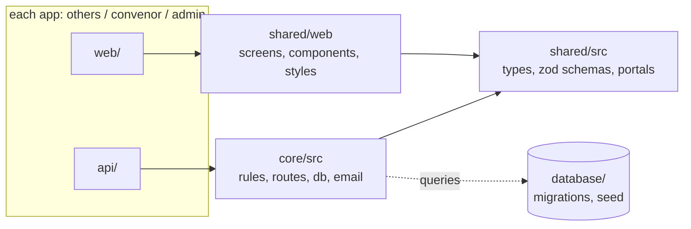
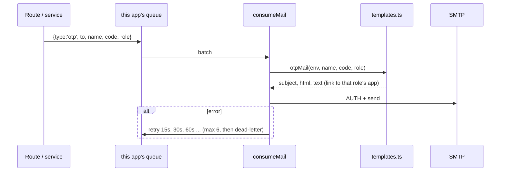
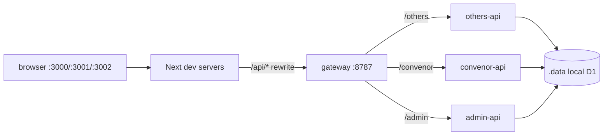

# Low-Level Design (LLD)

## 1. Folders and who may import whom



1. `web/` imports only `shared`. It talks to its own `api/` over HTTP only.
2. `api/` imports only `core` (and `shared/src` types).
3. `core` imports `shared/src` only. It never imports UI.
4. `shared/src` imports nothing from the project.
5. Only `database/migrations` changes the schema.

## 2. Web apps (`<app>/web`)

```
others/web/
├── package.json  next.config.mjs  tsconfig.json  tailwind.config.ts  postcss.config.mjs
├── open-next.config.ts  wrangler.json          deploy settings for Cloudflare
├── .env.example                                names, links, API address, DEV_TOOLS flag
├── public/manifest.webmanifest                 this app's installable (PWA) name
└── src/
    ├── portal.ts                               which app this is (title, allowed roles)
    ├── middleware.ts                           no cookie → /login
    └── app/
        ├── layout.tsx  not-found.tsx
        ├── login/page.tsx                      <Login portal={portal}/>
        └── (app)/layout.tsx                    <PortalLayout/>: sign-in gate + sidebar
            └── <route>/page.tsx                one line: export { default } from '@ui/pages/<page>'
```

`@ui/*` is a path alias to `shared/web/*` (set in each `tsconfig.json`).

### Pages per app

| Route | convenor | admin | others | Screen |
|---|:-:|:-:|:-:|---|
| `/login` | ✔ | ✔ | ✔ | `pages/login.tsx` |
| `/home` | ✔ | ✔ (→ `/admin`) | ✔ | `pages/home.tsx` |
| `/tickets/[id]` | ✔ | | ✔ | `pages/ticket.tsx` |
| `/support` | ✔ | | ✔ | `pages/support.tsx` |
| `/workflows`, `/convenor/permissions` | ✔ | | | `workflows.tsx`, `permissions.tsx` |
| `/admin`, `/admin/create`, `/admin/committees`, `/admin/support` | | ✔ | | `admin-*.tsx` |
| `/requests/new`, `/members/new`, `/team`, `/me` | | | ✔ | `requests-new`, `members-new`, `team`, `me` |

### Navigation speed

- Production builds are static, so each page's code is prefetched when its link is visible.
- The signed-in person is cached for the tab (`sessionStorage`), so a reload shows the shell at once and confirms in the background.
- While the person is on one page, the next pages' data (stats, committees) is fetched in idle time.
- Query results stay fresh for 20 seconds, so going back is instant.
- `next dev` uses Turbopack (`dev:webpack` is the fallback), which removes the compile wait on first visit.
- Measured locally on a production build: 80 to 250 ms from click to a fully drawn page.

### Developer tools

`shared/web/components/dev-tools.tsx` shows the query inspector only if `NODE_ENV` is not production **and** `NEXT_PUBLIC_DEV_TOOLS=true`. The same flag controls the Next.js dev badge (`shared/web/next-config.mjs`).

## 3. APIs

### 3.1 What an API folder holds

```
others/api/
├── package.json  tsconfig.json  wrangler.json
└── src/index.ts          const app = createApp('others'); export { fetch, queue }
```

`createApp(portal)` (in `core/src/app.ts`) builds the Hono app and mounts only the route groups of that portal:

| Group | others | convenor | admin |
|---|:-:|:-:|:-:|
| auth, notifications, files/uploads, committees | ✔ | ✔ | ✔ |
| tickets | ✔ | ✔ | |
| mail (send email) | ✔ (Lead) | ✔ | |
| support | ✔ | ✔ | ✔ |
| users | ✔ (members, directory) | ✔ (directory) | ✔ (all people) |
| grants (permissions) | | ✔ | ✔ |
| system (test email) | | | ✔ |

Admin also runs the hourly cleanup cron. Each API consumes its own mail queue.

### 3.2 Request pipeline

`portal tag → security headers → dev upload CORS → origin check → route → requireAuth (session, role belongs to this portal) → requireRole → handler`

### 3.3 Layers in `core/src`

```
app.ts            createApp(portal)
env.ts            settings, origin rules, emailMode(), otpRequired()
middleware/       security.ts, auth.ts (sessions, cookie names, assertPortal)
routes/           HTTP only: parse, authorise, call a service, shape the answer
services/         business rules: access, tickets, users, notify, grants
lib/              db, crypto, errors, ratelimit, files, cleanup, mail/{queue,send,templates}
```

### 3.4 Sessions and cookies

- Production: cookie `__Host-dastaan_sid`. Each domain has its own cookie; the session row is in the shared database.
- Development: `dastaan_<app>_sid`, because every app is on `localhost`.
- `assertPortal(portal, role)` answers `403 WRONG_PORTAL` with `fields.portal` so the web app can link to the right app.

### 3.5 Endpoints

| Area | Endpoints |
|---|---|
| Auth | `GET /auth/config`, `POST /auth/otp/request`, `POST /auth/otp/verify`, `POST /auth/admin/login`, `GET /auth/me`, `POST /auth/logout` |
| Requests | `GET /tickets`, `/tickets/stats`, `/tickets/:id`; `POST /tickets`, `/:id/status`, `/assign`, `/forward`, `/work-done`, `/redo`, `/comments` |
| People | `GET/POST /users`, `PATCH/DELETE /users/:id`, `/users/export.csv` (admin); `/users/members…` (lead); `/users/directory` |
| Committees | `GET /committees`, `/:id/people`, `/:id/logo`; `POST/PATCH/DELETE` (admin, with permission) |
| Permissions | `GET/POST /grants`, `POST /grants/:id/decision` |
| Mail, support, notifications, files | `POST /mail`; `/support…`; `/notifications…`; `POST /uploads`, `GET /files/:id` |
| System | `GET /system/status`, `POST /system/test-mail` (admin) |
| Dev only | `GET /dev/outbox`, `POST /dev/test-mail` (never in production) |

### 3.6 Email pipeline



Job types: `otp`, `user-created`, `ticket-context`, `broadcast`. `smtpSettings()` names any missing value. `sendTestMail()` sends at once and returns the real SMTP error.

### 3.7 Sign-in code details

1. Look up the person. If their role belongs to another app: `WRONG_PORTAL` (nothing is mailed).
2. Rate limit: 1 code per 30 s and 6 per hour per email; 25 per 10 min per address.
3. Store only an HMAC of the 6-digit code; cancel older codes; queue the email.
4. Verify: 5 tries, 30 minutes, constant-time compare, then create the session.

## 4. Database (`database/`)

`migrations/0001` to `0004`: committees, sub_committees, users, sessions, otps, rate_limits, tickets (+hops, events, comments), attachments, notifications, mail_log, committee_grants, support_requests, audit_log, dev_outbox.

Local: `.data/` folder, shared by the three APIs through a small development gateway (`scripts/dev-gateway`) that runs the three Workers in one process (one SQLite file cannot be written safely by three separate processes). Production: one D1 database bound to all three Workers; the gateway is not used.

## 5. Local development wiring



`.env` is copied to each api's `.dev.vars` by `scripts/sync-env.mjs` before `npm run dev:api`.

## 6. Adding a feature (example: Budget page for Leads)

1. `shared/src/schemas.ts` + `types.ts`: body and DTO.
2. `database/migrations/0005_budget.sql`.
3. `core/src/routes/budget.ts` + `services/budget.ts`; add `budget` to `ROUTES` and to `MOUNT.others` in `core/src/app.ts`.
4. `shared/web/pages/budget.tsx`.
5. `others/web/src/app/(app)/budget/page.tsx`: `export { default } from '@ui/pages/budget';`
6. Sidebar entry in `shared/web/lib/nav.ts`.
7. `npm run typecheck && npm run test:e2e`.

## 7. Tests

| Level | Where | Command |
|---|---|---|
| Unit | `core/test/unit.test.ts` | `npm run test` |
| End to end across the three APIs | `tests/e2e.mjs` | `npm run test:e2e` |
| Email path | `scripts/mail-test.mjs`, Admin "Send test email" | `npm run mail:test -- you@example.com` |
| Types and builds | all folders | `npm run typecheck`, `npm run build` |
